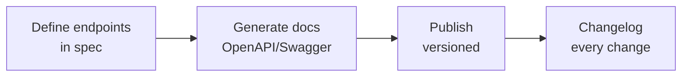

# API Documentation Template

## Template Structure

Use this template as the foundation for documenting any HTTP API. Copy it into your repo or docs site and replace every `[bracketed]` placeholder with your API-specific content. If what you actually need is interactive docs generated from a spec, follow [OpenAPI 3.1 API Docs with Swagger UI and Redoc](/recipes/api-documentation-openapi/) instead. For per-component documentation, use the [Component API Documentation Template](/docs/component-api-documentation-template/).

**Companion files:** the [api-documentation companion repo](https://mathiaspaulenko.github.io/stack-practices-resources/resources/docs/templates/api-documentation/) has a fill-in-ready copy of this template plus a matching OpenAPI fragment.

---

## 1. Overview

### Base URL

```text
https://api.example.com/v1
```

### Authentication

All endpoints require a Bearer token in the `Authorization` header:

```text
Authorization: Bearer <your_api_key>
```

Document the flow your API actually uses — API key, OAuth 2.0, or JWT — and link to the token endpoint. The [Authentication Options](#authentication-options-to-document) section below shows what each variant should include.

### Content-Type

Requests and responses use `application/json` unless specified otherwise. See [Parse JSON](/recipes/parse-json/) for handling JSON payloads.

### Rate Limits

- 100 requests per minute for authenticated users
- 10 requests per minute for anonymous users
- Rate limit headers included in all responses:
  - `X-RateLimit-Limit`
  - `X-RateLimit-Remaining`
  - `X-RateLimit-Reset`

### Versioning

This API is versioned in the URL path (`/v1`, `/v2`). Breaking changes ship under a new version, and every version change lands in the [Changelog](#5-changelog). Header-based versioning works too — pick one scheme and document it before the endpoints, not inside each one.

---

## 2. Endpoints

### [Resource Name]

#### `GET /[resource]`

List all [resources] with optional filtering and pagination.

**Query Parameters**

| Parameter | Type | Required | Description |
|-----------|------|----------|-------------|
| `page` | integer | No | Page number (default: 1) |
| `limit` | integer | No | Items per page (default: 20, max: 100) |
| `sort` | string | No | Sort field and direction (`created_at:desc`) |
| `filter[field]` | string | No | Filter by field value |

**Response `200 OK`**

```json
{
  "data": [
    {
      "id": "string",
      "created_at": "2026-01-01T00:00:00Z",
      "updated_at": "2026-01-01T00:00:00Z"
    }
  ],
  "meta": {
    "page": 1,
    "limit": 20,
    "total": 100,
    "total_pages": 5
  }
}
```

#### `POST /[resource]`

Create a new [resource].

**Request Body**

```json
{
  "name": "string (required, max 255 chars)",
  "description": "string (optional, max 1000 chars)"
}
```

**Response `201 Created`**

```json
{
  "id": "string",
  "name": "string",
  "description": "string",
  "created_at": "2026-01-01T00:00:00Z"
}
```

#### `GET /[resource]/{id}`

Retrieve a single [resource] by ID.

**Path Parameters**

| Parameter | Type | Required | Description |
|-----------|------|----------|-------------|
| `id` | string | Yes | Unique resource identifier |

**Response `200 OK`**

```json
{
  "id": "string",
  "name": "string",
  "description": "string",
  "created_at": "2026-01-01T00:00:00Z",
  "updated_at": "2026-01-01T00:00:00Z"
}
```

#### `PATCH /[resource]/{id}`

Partially update a [resource]. Only provided fields are modified.

**Request Body**

```json
{
  "name": "string (optional)",
  "description": "string (optional)"
}
```

**Response `200 OK`**

```json
{
  "id": "string",
  "name": "string",
  "description": "string",
  "updated_at": "2026-01-01T00:00:00Z"
}
```

#### `DELETE /[resource]/{id}`

Delete a [resource] by ID.

**Response `204 No Content`**

---

## 3. Error Responses

All errors follow this structure. For a dedicated error response template, see [API Error Response Template](/docs/api-error-response-template/). See [Input Validation](/recipes/input-validation/) for request validation patterns.

```json
{
  "error": {
    "code": "invalid_request",
    "message": "Human-readable description",
    "details": [
      {
        "field": "name",
        "issue": "is required"
      }
    ]
  }
}
```

### Common HTTP Status Codes

| Status | Code | Description |
|--------|------|-------------|
| 400 | `bad_request` | Malformed request or validation error |
| 401 | `unauthorized` | Missing or invalid authentication |
| 403 | `forbidden` | Insufficient permissions |
| 404 | `not_found` | Resource doesn't exist |
| 409 | `conflict` | Resource conflict (e.g., duplicate unique field) |
| 422 | `unprocessable_entity` | Semantic validation error |
| 429 | `rate_limited` | Too many requests |
| 500 | `internal_error` | Server-side error |

---

## 4. SDKs & Tools

- **cURL**: every example in this template runs with plain cURL — keep the commands copy-pasteable so users can test endpoints in seconds.
- **Postman**: publish a collection or an importable [OpenAPI spec](https://api.example.com/openapi.json) so users can load the whole API in one click.
- **OpenAPI**: the auto-generated spec lives at `/openapi.json`. If you maintain it by hand, lint it in CI — stale specs are worse than none.

---

## 5. Changelog

| Version | Date | Changes |
|---------|------|---------|
| 1.0.0 | 2026-06-10 | Initial release |

---

## Customization Guide

1. Replace `[resource]` with your actual domain entity (e.g., `users`, `orders`, `products`)
2. Add endpoint-specific query parameters and response fields
3. Include authentication examples for OAuth, API keys, or JWT
4. Add code examples in Python, JavaScript, and Java
5. Link to your OpenAPI/Swagger spec for interactive documentation

The diagram below maps the docs workflow this template assumes: define the spec, generate or hand-write the docs, publish versioned, and log every change.



## How to Use This Template

Work through it in this order and the result reads like real API documentation, not a skeleton:

1. **Fill the Overview first.** Base URL, auth, and rate limits are the first things every consumer looks for. If readers can't authenticate in two minutes, nothing below this section matters.
2. **Document one resource completely before duplicating.** Get `GET`, `POST`, `PATCH`, and `DELETE` right for a single resource — params table, request body, response example — then copy the pattern to the rest. Consistency beats coverage.
3. **Write examples from real responses.** Copy an actual response body and anonymize it. Invented examples drift from reality fast and erode trust in the whole doc.
4. **Run every example once.** A request example that doesn't work is worse than no example — users blame your API, not your docs.
5. **Publish versioned and keep the changelog honest.** Docs and API must move together; the changelog is what tells consumers whether they need to act.

## Authentication Options to Document

Pick the section that matches your API and adapt the fields. Leave the other variants out — documented-but-unused auth methods confuse consumers.

| Method | What to document | Where it lives |
|--------|------------------|----------------|
| API key | Header name (`X-API-Key` or `Authorization`), how to request a key, rotation policy | Overview + each request example |
| OAuth 2.0 | Grant type (`client_credentials` vs `authorization_code`), token endpoint, scopes table, token TTL | Dedicated "Getting a token" section |
| JWT | Issuer, signing algorithm (`RS256`/`HS256`), expiry, refresh flow | Overview + a "Token claims" subsection |

An OAuth 2.0 client-credentials block typically looks like this in the docs:

```text
POST /oauth/token
Content-Type: application/x-www-form-urlencoded

grant_type=client_credentials&client_id=<id>&client_secret=<secret>&scope=read:orders
```

```json
{
  "access_token": "eyJhbGciOiJSUzI1NiIs...",
  "token_type": "Bearer",
  "expires_in": 3600,
  "scope": "read:orders"
}
```

Mention clock skew and expiry handling — it's the most common auth ticket docs teams get.

## Pagination Patterns

Choose one strategy per collection endpoint and document it once in the Overview, then reference it from each list endpoint.

| Pattern | Params | Best for | Watch out for |
|---------|--------|----------|---------------|
| Offset (`page`/`limit`) | `page`, `limit` | Admin UIs, small datasets | Deep pages get slow; rows shift under inserts |
| Cursor | `cursor`, `limit` | Feeds, large datasets, real-time data | No random page access; cursor must be opaque |
| Keyset (`after_id`) | `after_id`, `limit` | Ordered lists with stable sort | Requires an indexed sort column |

A cursor response should carry the next token in `meta` so clients don't parse URLs:

```json
{
  "data": [{ "id": "ord_123" }],
  "meta": { "next_cursor": "eyJpZCI6Im9yZF8xMjMifQ==", "has_more": true }
}
```

## Documenting GraphQL

GraphQL APIs need a different layout than the REST sections above — there's one endpoint (`POST /graphql`) and the schema *is* the contract. Document it like this:

- **Operations**: each supported query and mutation with its signature, required variables, and a runnable example.
- **Fields**: non-obvious fields only — a self-describing schema doesn't need a comment for `id`.
- **Errors**: GraphQL returns `200` with an `errors` array, so document the error shape separately from HTTP codes.

```graphql
query GetOrder($id: ID!) {
  order(id: $id) {
    id
    status
    total { amount currency }
    items { sku quantity }
  }
}
```

```json
{
  "data": { "order": { "id": "ord_123", "status": "SHIPPED", "total": { "amount": 49.9, "currency": "USD" } } }
}
```

Point readers at the schema browser (GraphiQL, Apollo Sandbox) instead of duplicating the whole schema in prose.

## Documenting Webhooks

If your API pushes events, give them their own section — they're APIs in reverse and teams forget to document them.

For each event document: the event name, the payload schema with a real example, the delivery semantics (at-least-once), retries and backoff, and how consumers verify signatures.

```text
POST https://consumer.example.com/webhooks
X-Signature: sha256=<hmac_hex>
X-Event-Type: order.shipped
```

```json
{
  "id": "evt_9f2c1",
  "type": "order.shipped",
  "created_at": "2026-01-15T10:30:00Z",
  "data": { "order_id": "ord_123", "tracking": "1Z999AA10123456784" }
}
```

Always document how to verify the signature and how to replay events — those are the two questions every integrator asks.

## Client Examples

One working example per mainstream language covers most readers. Keep them minimal — the goal is a first successful request in under a minute.

```bash
curl -H "Authorization: Bearer <your_api_key>" \
     -H "Content-Type: application/json" \
     https://api.example.com/v1/orders?page=1&limit=10
```

```python
import requests

resp = requests.get(
    "https://api.example.com/v1/orders",
    headers={"Authorization": "Bearer <your_api_key>"},
    params={"page": 1, "limit": 10},
    timeout=10,
)
resp.raise_for_status()
orders = resp.json()["data"]
```

```javascript
const resp = await fetch('https://api.example.com/v1/orders?page=1&limit=10', {
  headers: { Authorization: `Bearer ${process.env.API_KEY}` },
});
if (!resp.ok) throw new Error(`API error: ${resp.status}`);
const { data: orders } = await resp.json();
```

## Worked Example: the `orders` Endpoint Filled In

This is what the template looks like once a real resource replaces the placeholders — use it as the reference for tone and level of detail:

#### `GET /orders`

List the caller's orders, newest first.

**Query Parameters**

| Parameter | Type | Required | Description |
|-----------|------|----------|-------------|
| `limit` | integer | No | Items per page (default: 20, max: 100) |
| `status` | string | No | Filter by status: `pending`, `paid`, `shipped`, `cancelled` |
| `created_after` | string | No | ISO-8601 date; orders created after it |

**Response `200 OK`**

```json
{
  "data": [
    {
      "id": "ord_9x2k",
      "status": "shipped",
      "total": { "amount": 129.5, "currency": "USD" },
      "created_at": "2026-01-14T18:22:00Z"
    }
  ],
  "meta": { "page": 1, "limit": 20, "total": 87, "total_pages": 5 }
}
```

**Error `400 Bad Request`**

```json
{
  "error": {
    "code": "invalid_request",
    "message": "status must be one of: pending, paid, shipped, cancelled",
    "details": [{ "field": "status", "issue": "invalid enum value" }]
  }
}
```

Notice what the filled version does that the skeleton doesn't: the endpoint description says *whose* orders come back (`the caller's` — the resource is scoped to the authenticated user), the `status` parameter lists its real enum values, and the error example shows the `400` a bad `status` actually produces. That specificity is what consumers need to integrate without a support ticket.

## Environments and Headers

If you offer a sandbox, document it next to the production base URL — integrators should never hit production by accident while testing:

| Environment | Base URL | Purpose |
|-------------|----------|---------|
| Production | `https://api.example.com/v1` | Live traffic |
| Sandbox | `https://sandbox.api.example.com/v1` | Testing with seeded data |

Beyond auth, document the custom headers your API honors on every request:

| Header | Direction | What it does |
|--------|-----------|--------------|
| `X-Request-ID` | request/response | Trace ID echoed back — ask users to log it for support tickets |
| `Idempotency-Key` | request | Makes `POST` retries safe; the server deduplicates by key |
| `ETag` / `If-None-Match` | response/request | Conditional reads; returns `304` when nothing changed |

```text
POST /v1/orders
Idempotency-Key: 8f3d2a1c-9e7b-4f5a-b2c1-0d8e6f4a3b2c
X-Request-ID: req_01HXYZAB3E
```

Say explicitly which headers are required vs optional, and whether the `Idempotency-Key` TTL is 24 hours, a week, or forever — that's the part every payments-style integration needs.

## Long-Running Operations

Endpoints that take longer than a normal request shouldn't hold the connection open. Document the async pattern if your API uses it — `202 Accepted` plus a status endpoint to poll:

```json
// POST /v1/exports → 202 Accepted
{
  "job_id": "job_8x2k",
  "status": "queued",
  "status_url": "https://api.example.com/v1/jobs/job_8x2k"
}
```

```json
// GET /v1/jobs/job_8x2k → 200 OK
{
  "job_id": "job_8x2k",
  "status": "completed",
  "result_url": "https://api.example.com/v1/exports/exp_4f1"
}
```

Document the polling cadence (e.g., start at 1s, back off to 30s max) or, better, a webhook alternative so clients don't poll at all.

## Deprecation and Sunset

Consumers plan months ahead — tell them early and in writing. When an endpoint or version is going away, document three things: the deprecation date, the sunset (removal) date, and the migration path.

| Endpoint | Deprecated | Sunset | Replacement |
|----------|-----------|--------|-------------|
| `GET /v1/reports` | 2026-03-01 | 2026-09-01 | `GET /v2/reports` |

If you emit `Deprecation` and `Sunset` response headers (RFC 8594 / RFC 9745), say so — automated tooling can pick them up:

```text
Deprecation: Sat, 01 Mar 2026 00:00:00 GMT
Sunset: Tue, 01 Sep 2026 00:00:00 GMT
Link: <https://api.example.com/v2/docs#reports>; rel="deprecation"
```

Keep deprecated endpoints in the docs until they're removed, clearly marked — deleting the doc before the endpoint dies leaves stragglers with no reference.

## Choosing Where the Docs Live

Three common homes, and the trade-offs: **in-repo Markdown** (this template in `docs/api/` next to the code) keeps docs in sync and reviewable but gives you no search or navigation out of the box. **A docs platform** (GitBook, Mintlify, ReadMe) renders beautifully with versioning and search but adds a second place to keep current. **Rendered from the spec** (Swagger UI, Redoc hosted next to the API) is always accurate for the contract but can't explain flows, so pair it with prose for auth and onboarding. Most teams land on docs-as-code in the repo plus a hosted spec renderer — that combination is what this template assumes.

## Docs-as-Code: Keeping It in CI

Treat the doc like code and it stays honest. Keep this file (or its generated equivalent) in the same repo as the API, review doc changes in the same pull request as the code change, and let CI catch drift:

- **Spec lint**: run `vacuum lint` or `spectral lint openapi.yaml` on every PR — a spec that doesn't validate can't generate docs.
- **Link check**: a nightly job over internal and external links catches dead anchors before users do.
- **Example tests**: execute the request examples against a staging environment on a schedule; a `200` that became a `404` shows up as a failing test, not a user complaint.
- **Changelog check**: enforce a changelog entry when the spec file changes — no silent schema edits.

Two rules keep the workflow sane: docs changes ride in the same PR as the API change that causes them, and whoever breaks the docs build fixes it. Without both, docs-as-code decays into docs-as-afterthought.

## What Good API Documentation Includes

Use this as the review checklist before publishing:

- **Authentication that works on first try** — a complete, tested auth example beats a paragraph of theory.
- **Real request/response pairs** — every endpoint shows an actual call and an actual response, not just schemas.
- **Error contract** — the error shape plus a table mapping HTTP codes to error codes, so clients can branch on them.
- **Limits and costs** — rate limits, pagination caps, and any quota that changes behavior.
- **Versioning and lifecycle** — current version, deprecation policy, and where the changelog lives.
- **An OpenAPI spec or interactive console** — humans read the guide, machines need the spec; ship both.

## Common Mistakes in API Documentation

- **Examples that were never executed**: they break silently when the API evolves. Test them in CI or regenerate them from the spec.
- **Documenting every field**: a table for `id`, `name`, `created_at` adds noise. Document fields that need explanation — enums, computed values, deprecated ones.
- **One page per concept scattered everywhere**: auth explained in three places drifts into three versions. Single-source it and link.
- **No error examples**: a perfect `200` example teaches half the contract. Show a `400` and a `429` too.
- **Docs published separately from the release**: if the changelog updates "later", consumers never trust it. Docs go out with the deploy.

## FAQ

**Q: Should I document every endpoint or only public ones?**
A: Document every endpoint that is consumed by clients, including internal microservices. Internal-only endpoints can have lighter documentation, but they should still be discoverable and understandable by other teams.

**Q: What is the difference between API documentation and an OpenAPI spec?**
A: API documentation is the human-readable guide with explanations, examples, and context. An [OpenAPI spec](/recipes/api-documentation-openapi/) is the machine-readable contract that powers interactive docs, client generation, and contract testing. Maintain both.

**Q: How do I keep API docs in sync with code?**
A: Generate documentation from code annotations or OpenAPI specs as part of your CI pipeline. Use tools like Swagger UI, Redoc, or Stoplight to render specs automatically. See [REST API Design Guide](/guides/rest-api-design-guide/) for what works in API design. Manual docs drift quickly without automation.

**Q: REST template or OpenAPI generator — which should come first?**
A: If a spec already exists, generate from it and write prose only where the schema can't carry meaning (auth flows, rate limits, error semantics). If you're still designing the API, start with this template — writing the contract by hand forces decisions the generator would otherwise guess.

**Q: How much detail belongs in each endpoint?**
A: Four things: what it does in one line, the parameters with types and constraints, a working request/response pair, and the errors it can return. Anything beyond that — edge cases, bulk behavior, deprecation notes — earns its place only if a consumer asked for it.

## Further Reading

- [OpenAPI Specification](https://spec.openapis.org/oas/latest.html) — the machine-readable contract standard
- [OpenAPI 3.1 API Docs with Swagger UI and Redoc](/recipes/api-documentation-openapi/) — generate interactive docs from a spec
- [API Error Response Template](/docs/api-error-response-template/) — dedicated error format template
